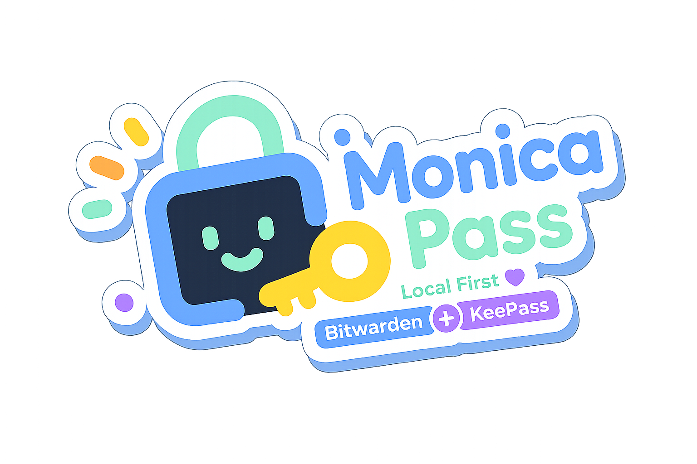

# Monica ローカルパスワード保管庫

[中文](README.md) | [English](README_EN.md) | **日本語** | [Tiếng Việt](README_VI.md) | [Русский](README_RU.md) | [黑羽川](彩蛋语言备份/README_Nya.md)

<strong>Bitwarden と KeePass をつなぐローカル優先のパスワード保管庫</strong>

Android · Local Vault · TOTP · WebDAV Backup

 

Monica は **Bitwarden** と **KeePass** を統合するローカルパスワード保管庫です。
ローカル優先の保存を中心に、Android 端末でパスワード、2FA、セキュアノート、添付ファイルを一元管理できます。

サイト: https://monica-pass.github.io/MonicaDocs/

---

## まずユーザー向け情報

### Monica が向いているユーザー
- クラウド依存ではなく、ローカル優先のパスワード管理を求めるユーザー。
- Bitwarden データと KeePass (`.kdbx`) の両方を扱うユーザー。
- Android アプリやモバイルブラウザで自動入力を使いたいユーザー。

### できること
- ログイン情報、カード情報、個人情報、ノート、添付ファイルをローカル暗号化保管。
- Android で Bitwarden API/同期機能と KeePass (`.kdbx`) 読み書きを両対応。
- 自前 WebDAV 基盤による任意の同期・バックアップ。
- アプリ内での TOTP 管理とコード生成。

### MDBX ローカルデータベース形式
MDBX は Monica が開発中のローカル優先暗号化 vault 形式です。単なるパスワード表ではなく、ネストしたフォルダ、添付ファイル、コミット履歴、競合検出、tombstone による削除管理、スナップショット復元、Tiga セキュリティモードを前提に設計されています。

他のクライアントで MDBX を接続する場合は、まず [MDBX workspace README](mdbx/README.en.md) と [MDBX client integration guide](mdbx/CLIENT_INTEGRATION_GUIDE.md) を読んでください。完全な形式仕様は [mdbx/docs](mdbx/docs/README.md) にあります。

### クイックインストール

1. [Releases](https://github.com/Monica-Pass/Monica-for-Android/releases) から最新 APK を取得。
2. Android 8.0+ にインストールし、マスターパスワードを初期設定。

### 既知の制限
- システム互換性の都合により、Monica for Android は一部の Xiaomi HyperOS 端末でパスキーを作成できません。酷 U さん提供の解決モジュール [HyperMonica](https://github.com/Wuming155/HyperMonica) をお試しください。

---

## Android 重点

### 主な機能
- ローカル Vault による資格情報保管。
- KeePass / Bitwarden との統合インポート。
- タイトル・ドメイン・タグでの高速検索。
- Android の生体認証によるロック解除。
- TOTP の一元保存と生成。

### 実装ポイント
- UI: Jetpack Compose + Material 3 + Navigation Compose。
- データ層: Room（`PasswordDatabase`）+ DAO + Repository。
- 非同期: Kotlin Coroutines + Flow。
- DI: Koin（`MonicaApplication` で初期化）。
- セキュリティ: Android Keystore、EncryptedSharedPreferences、BiometricPrompt。
- バックグラウンド処理: WorkManager（`AutoBackupWorker`）で WebDAV 自動バックアップ。
- プロトコル/連携: Retrofit + OkHttp（Bitwarden API）、kotpass（KeePass）、sardine-android（WebDAV）。

### セキュリティモデル
- 暗号化: AES-256-GCM（認証付き暗号）。
- KDF: PBKDF2-HMAC-SHA256（高反復パラメータ）。
- ローカル保護: マスターパスワードのハッシュと安全設定は端末内で管理。
- ネットワーク境界: アプリはネットワーク権限を宣言し、主に Bitwarden 連携と WebDAV 同期/バックアップに使用。

---

## サポート

Monica が役に立った場合は、継続開発とセキュリティ強化への支援をご検討ください。

 
WeChat / Alipay で支援

 

  
  

支援金の主な用途:
- セキュリティ強化と監査。
- Android UX と安定性改善。
- クロスプラットフォーム整合性とドキュメント整備。

---

## 開発者向け情報

### プロジェクト層（現行コード）
- `takagi/ru/monica/ui`: Compose 画面とコンポーネント。
- `takagi/ru/monica/data`: Room エンティティ、DAO、DB マイグレーション。
- `takagi/ru/monica/repository`: データアクセスのラッパー。
- `takagi/ru/monica/security`: 暗号化、鍵管理、認証関連ロジック。
- `takagi/ru/monica/bitwarden`: API、暗号、マッパー、同期、ViewModel。
- `takagi/ru/monica/autofill`: 自動入力サービスとフロー。
- `takagi/ru/monica/passkey`: Android 14+ Credential Provider 実装。
- `takagi/ru/monica/workers`: WebDAV 自動バックアップ等のバックグラウンド処理。
- `mdbx`: Monica MDBX ローカルデータベース形式の Rust workspace とクライアント接続ドキュメント。

### 現在使用中の主要コンポーネント（リポジトリで検証可能）
- Android UI: Jetpack Compose, Material 3, Navigation Compose。
- データ/状態: Room, DataStore Preferences, ViewModel。
- セキュリティ: Android Keystore, EncryptedSharedPreferences, BiometricPrompt。
- 通信/プロトコル: Retrofit, OkHttp, Kotlinx Serialization。
- 同期/エコシステム: sardine-android (WebDAV), kotpass (KeePass), Bitwarden API 連携。
- 非同期/ジョブ: Coroutines, Flow, WorkManager。
- 追加機能: CameraX + ML Kit（QR スキャン）, Credentials API（Passkey）。

### ビルドとコントリビューション
- Android Studio: 最新安定版。
- JDK: 17+。
- Android 設定: `compileSdk 35`, `targetSdk 34`, `minSdk 26`（`Monica for Android/app/build.gradle`）。
- Android ビルド基準: AGP `8.6.0`, Kotlin `2.0.21`, Compose BOM `2026.03.00`（Material3 は BOM に追従）。
- バージョンの一次情報: `Monica for Android/gradle/libs.versions.toml` と `Monica for Android/app/build.gradle`。
- Issue / PR でのコントリビューション歓迎。

---

## 謝辞

Monica の設計、互換性対応、そして一部の機能方針は、以下の優れたオープンソースプロジェクトやソフトウェアから多くの着想と支援を受けています。

- [Keyguard](https://github.com/AChep/keyguard-app) - Android 向けパスワードマネージャーの操作設計と UX の参考。
- [PixelPlayer](https://github.com/PixelPlayerHQ/PixelPlayer) - Android 版のパスワード保管庫のスクロールバースタイルの参考。
- [Bitwarden](https://bitwarden.com/) - オープンソースのパスワード管理エコシステム、Vault モデル、同期機能における重要な参考。
- [KeePass](https://keepass.info/) - ローカル Vault という思想と `.kdbx` エコシステム互換性の基盤。
- [Stratum Auth](https://github.com/stratumauth/app) - 認証アプリ体験、アイコン資産、関連互換対応の参考。
- [Steam Desktop Authenticator](https://github.com/Jessecar96/SteamDesktopAuthenticator) - Steam maFile 形式、Steam Guard、取引確認互換性の参考。
- [steamguard-cli](https://github.com/dyc3/steamguard-cli) - Steam Guard ログイン、認証器移行、確認プロトコル実装の参考。
- [AnotherVaporAuth](https://github.com/freefrank/AnotherVaporAuth) - Steam モバイル認証器、ログイン承認、確認フロー体験の参考。

---

## 友好リンク

- [Linux.do](https://linux.do)
- [TinadecOffice](https://github.com/Tinadec/TinadecOffice)

---

## Star History

---

## 貢献者

---

## コミュニティとサポート

- Telegram グループ: [Monica コミュニティに参加](https://t.me/+IZUDLL-vWOA1Y2U1)

---

## ライセンス

Copyright (c) 2025 JoyinJoester

Monica は [GNU General Public License v3.0](LICENSE) で公開されています。

## サードパーティアイコン表記

- 本プロジェクトには [Stratum Auth app](https://github.com/stratumauth/app) のアイコン資産をローカル同梱しています（バージョン [v1.4.0](https://github.com/stratumauth/app/releases/tag/v1.4.0)、ディレクトリ [icons](https://github.com/stratumauth/app/tree/v1.4.0/icons) / [extraicons](https://github.com/stratumauth/app/tree/v1.4.0/extraicons)、GPL-3.0）。
- 銀行カード／決済カードアイコンの出典：ローカルディレクトリ [SVG Credit Card & Payment Icons](svg-credit-card-payment-icons-main)（Apache-2.0）。
- ブランド名およびロゴの商標権は各権利者に帰属します。

## F-Droid contact

For F-Droid metadata or packaging issues, contact: joyin8888@foxmail.com

